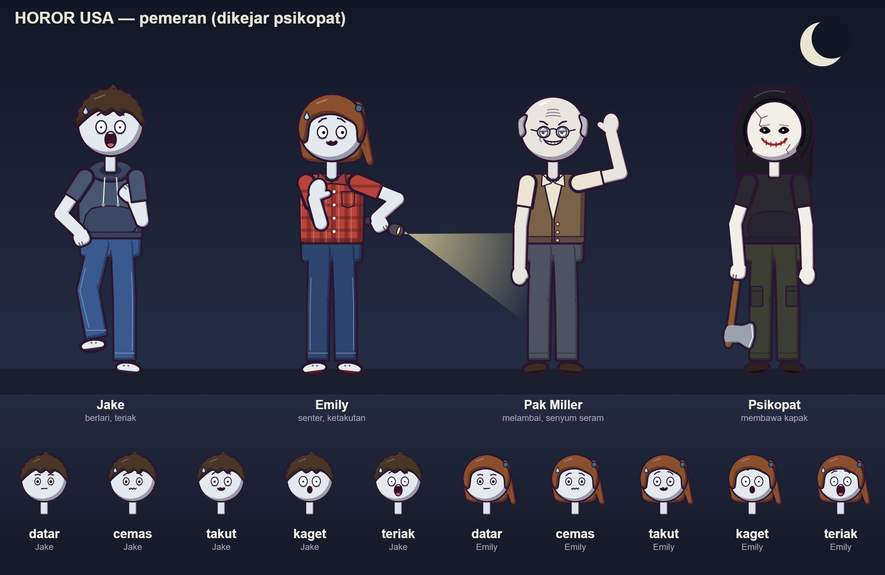
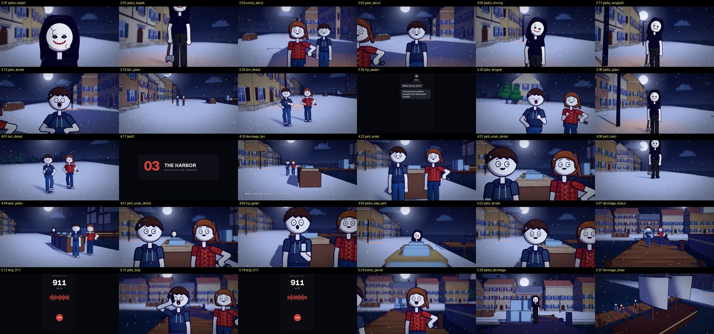
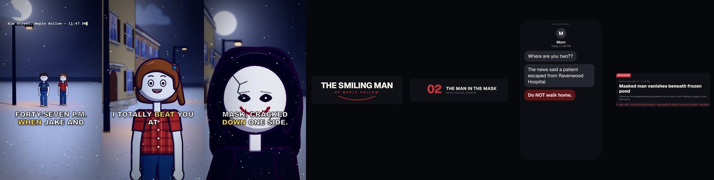
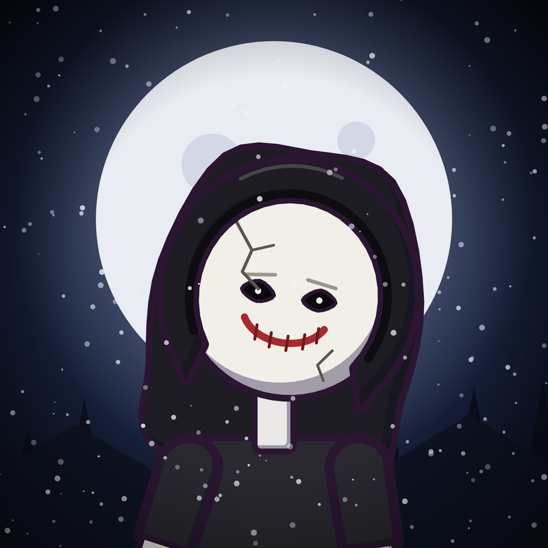

# stickman-indonesia-animate-claude

Skill Claude Code **`animasi-horor-kartun`**: membuat video animasi horor kartun lengkap — dari naskah sampai siap unggah — dengan tokoh kartun kepala bulat di dunia 3D malam bersalju. Dibuat dan diuji lewat episode nyata **"The Smiling Man of Maple Hollow"** (8:15, 1920x1080, YouTube, penonton Amerika).

*A Claude Code skill that produces complete animated horror cartoon videos (round-head cartoon characters in a snowy 3D night town): English script, emotional character voices, motion graphics, CC0 sound design, -16 LUFS mix, resumable chunked rendering, automatic QA, subtitles and a YouTube upload kit — in 16:9 for YouTube or 9:16 for Shorts / Reels / TikTok.*



| 16:9 YouTube | 9:16 Shorts / Reels / TikTok | Foto profil |
|---|---|---|
|  |  |  |

## Isi skill
| Bagian | Isi |
|---|---|
| Tokoh | Jake, Emily, Mr. Miller, si Psikopat bertopeng ("The Smiling Man"): satu bentuk badan tetap, 11 ekspresi, pose lengan (lari, senter, menelepon, ponsel, kapak, melambai, takut, menunjuk), tampak belakang, kepala miring, mulut bergerak mengikuti suara |
| Dunia 3D | jalan Elm Street bersalju, rumah, lampu jalan, pelabuhan, dermaga, kapal tua, kolam beku dengan es retak; preset malam dan fajar; bulan purnama; salju turun; sirene |
| Suara | [Supertonic 3](https://github.com/supertone-oss-archive/supertonic-py): suara berbeda per tokoh, 8 emosi, intonasi per kalimat supaya tidak datar |
| Motion-graphics | mesin motion-broll [Barty-Bart/motion-graphics](https://github.com/Barty-Bart/motion-graphics): kartu judul, kartu bab, layar ponsel, panggilan 911, berita BREAKING |
| Efek suara | [Lots of Sounds free API](https://github.com/lotsofsounds/free-sound-effects-api) (CC0) + kit CC0 skill sound-effects; mixing otomatis -16 LUFS (-14 untuk Shorts) |
| Render | per potongan 1 menit, bisa dilanjutkan kalau terhenti; pengecekan otomatis (frame, layar hitam, gambar diam, keras suara) dan lembar kontak per shot |
| Unggah | subtitle SRT, judul, deskripsi, timestamp bab, hashtag & tag, foto profil kanal |

## Pasang
1. Salin `skills/animasi-horor-kartun` ke folder skill Claude Code Anda: `~/.claude/skills/animasi-horor-kartun` (Windows: `C:\Users\<nama>\.claude\skills\`).
2. Ikuti `skills/animasi-horor-kartun/references/setup.md` sekali per komputer: proyek Remotion ([ryanmhildan/cartoon-3d-shorts](https://github.com/ryanmhildan/cartoon-3d-shorts)), mesin motion-graphics, Supertonic (Python 3.11), ffmpeg dengan rubberband, Chrome.
3. Minta ke Claude Code, misalnya:
   - "buat episode 2 Horor USA, Jake dan Emily terjebak di mercusuar"
   - "buat versi Shorts 60 detik dari episode 1"
   - "tambahkan tokoh baru: sheriff kota, suara pria berat"

## Dipakai di AI lain
Selain Claude Code, skill ini bisa dipakai agen AI lain (Codex, Cursor, Gemini, dll.). Mulai dari `skills/animasi-horor-kartun/AGENTS.md` (ringkas dan lintas-AI), lalu `SKILL.md` dan `references/` untuk detailnya. Lokasi komputer diatur lewat variabel `REMO_DIR`, `SUARA_PY`, dan `CHROME_PATH` (lihat `references/setup.md`).

## Struktur
```
skills/animasi-horor-kartun/
  SKILL.md                 alur kerja + aturan + jebakan
  references/              setup, tokoh, dunia & kamera, suara & efek suara, render & QA & unggah
  templates/remotion/      folder video Remotion (16:9 / 9:16 lewat format.ts)
  templates/tokoh/         gambar semua tokoh + lembar karakter
  templates/suara/         suara Supertonic, timeline, audisi, mixing, subtitle
  templates/motion/        pembuat klip motion-graphics
  templates/render_ep.py   render per potongan
  templates/branding/      foto profil kanal
  scripts/                 lembar kontak, pengecekan video, stills
  examples/ep1/            naskah, isyarat efek suara, spesifikasi klip, teks YouTube episode 1
```

## Sumber & lisensi pihak ketiga
- Mesin tampilan 3D (tinta, lensa, grade, kartu tokoh, dunia) diturunkan dari skill `cartoon-3d-short` (mromidev/claude-animated-shorts, MIT — lihat `templates/remotion/LICENSE-cartoon-3d-short.txt`) lewat repo [ryanmhildan/cartoon-3d-shorts](https://github.com/ryanmhildan/cartoon-3d-shorts) (tata letak dunia `island.ts`). Model 3D Kenney (CC0) tidak disertakan; diambil dari repo itu.
- Motion-graphics memakai mesin [Barty-Bart/motion-graphics](https://github.com/Barty-Bart/motion-graphics) (MIT, tidak disertakan; dipasang saat setup). Font Geist (OFL).
- Suara: [Supertonic 3](https://github.com/supertone-oss-archive/supertonic-py) (paket & model mengikuti lisensinya; tidak disertakan).
- Efek suara: sampel CC0 dari [Lots of Sounds](https://www.lotsofsounds.com) dan kit CC0 skill sound-effects; diunduh saat dipakai, tidak disimpan di repo.
- Tokoh, cerita, naskah, dan kode skill ini: dibuat bersama Claude Code untuk channel penulis.
